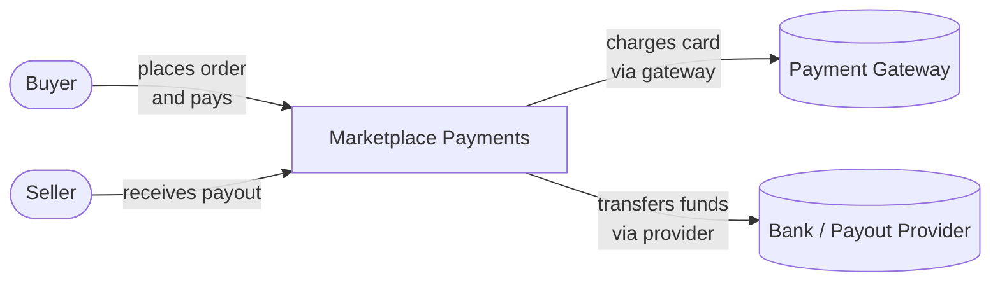
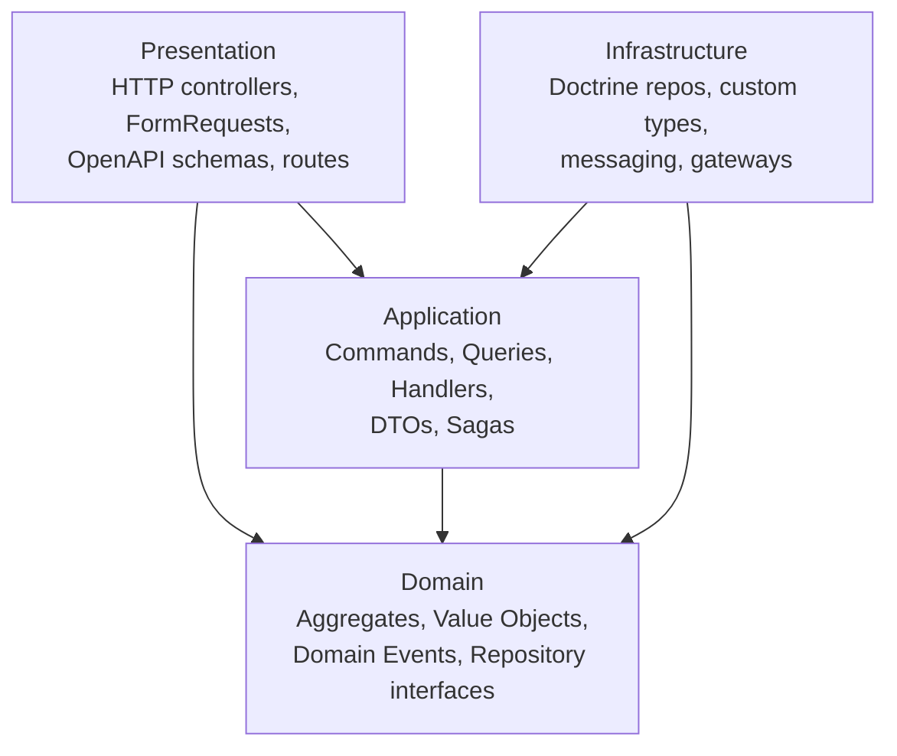

[← Documentation Index](README.md)

# Architecture

System-level view of the Marketplace Payments platform: how the three
services are organised, how they communicate, what each owns, and the design
principles that hold the whole thing together.

---

## C4 Model Overview

We document the architecture using the [C4 model](https://c4model.com/) —
a lightweight, hierarchical approach that describes a system at multiple
levels of zoom. This document covers two levels:

- **Level 1 — System Context.** The system as a single black box, together
  with its users and external dependencies.
- **Level 2 — Containers.** The deployable units inside the system (services,
  databases, message broker) and how they interact.

Two deeper levels (Components and Code) are intentionally not part of this
document — they map to the internal package structure documented in
[Bounded Contexts](bounded-contexts.md) and to the source code itself.

---

## System Context

Marketplace Payments sits between buyers, sellers, and an external payment
gateway. From the outside it is a single system: a buyer places an order and
pays; a seller receives a payout. Internally it is three cooperating services.



**Actors**

- **Buyer** — initiates orders and payments. Talks to the Order API and
  Payment API.
- **Seller** — receives payouts. Sellers do not initiate anything; the
  platform pushes money to them after the buyer's payment clears.
- **Payment Gateway** — external provider that charges the buyer's card.
  Modelled as `FakePayoutGateway` in this demo; the interface `PayoutGateway`
  is the real contract.
- **Bank / Payout Provider** — external destination for seller payouts.
  Same: emulated behind `PayoutGateway`.

---

## Container View

Inside Marketplace Payments, three Laravel applications run side by side.
Each owns its own PostgreSQL database and communicates with the others
**exclusively through RabbitMQ**. There are no direct HTTP calls between
services, no shared database, no shared repository code.

```mermaid
flowchart TB
    subgraph Client["Clients"]
        Browser[Swagger UI / cURL]
    end

    subgraph API["API Layer (nginx)"]
        NginxOrder[Order :8001]
        NginxPay[Payment :8002]
        NginxPay out[Payout :8003]
    end

    subgraph Services["Service Layer"]
        Order["Order Service<br/>Laravel 11 + Ecotone<br/>Saga orchestrator"]
        Payment["Payment Service<br/>Laravel 11 + Ecotone<br/>Payment + Refund"]
        Payout["Payout Service<br/>Laravel 11 + Ecotone<br/>Payout + SellerBalance"]
    end

    subgraph Storage["Data Layer"]
        DBOrder[(order_db)]
        DBPay[(payment_db)]
        DBPayout[(payout_db)]
    end

    MQ{{RabbitMQ<br/>exchange: ecotone.distributed}}

    Browser --> NginxOrder
    Browser --> NginxPay
    Browser --> NginxPayout

    NginxOrder --> Order
    NginxPay --> Payment
    NginxPayout --> Payout

    Order --> DBOrder
    Payment --> DBPay
    Payout --> DBPayout

    Order <--> MQ
    Payment <--> MQ
    Payout <--> MQ
```

**Container responsibilities**

| Container | Role |
|---|---|
| **Order Service** | Owns the `Order` aggregate and hosts the `OrderFulfillmentSaga`. Exposes the public order API. |
| **Payment Service** | Owns the `Payment` aggregate and `Refund` entities. Emulates an external card gateway via `PaymentGateway`. |
| **Payout Service** | Owns the `Payout` aggregate and the `SellerBalance` ledger. Emulates an external bank transfer via `PayoutGateway`. |
| **PostgreSQL × 3** | One database per service. No cross-database queries. |
| **RabbitMQ** | Single broker. All cross-service messaging flows through `ecotone.distributed`. |
| **nginx × 3** | Front-end proxies for the three APIs. |

---

## Communication Patterns

All inter-service communication is **asynchronous**, **message-based**, and
**contract-defined**. Two patterns are used:

### Publish / Subscribe

Events broadcast a state change and are consumed by zero or more subscribers.
Routing keys in this project:

| Routing key | Producer | Consumer | Payload |
|---|---|---|---|
| `order.created` | Order | Payment | `OrderCreatedMessage` |
| `payment.completed` | Payment | Order | `PaymentCompletedMessage` |
| `payout.completed` | Payout | Order | `PayoutCompletedMessage` |
| `payout.failed` | Payout | Order | `PayoutFailedMessage` |

Example — a payment service consumer:

```php
#[Distributed]
#[EventHandler('order.created')]
public function handle(OrderCreatedMessage $message): void
{
    $this->commandBus->send(new InitiatePaymentCommand(
        orderId: $message->orderId,
        buyerId: $message->buyerId,
        amount: $message->amount,
        currency: $message->currency,
        method: 'card',
    ));
}
```

### Point-to-Point Commands

Commands are sent to a specific service and expect that service to act.
Routing keys:

| Routing key | Producer | Consumer | Payload |
|---|---|---|---|
| `payment.capture` | Order | Payment | `CapturePaymentMessage` |
| `payout.create` | Order | Payout | `CreatePayoutMessage` |

Example — a payment service command consumer:

```php
#[Distributed]
#[CommandHandler('payment.capture')]
public function handle(CapturePaymentMessage $message): void
{
    $orderId = OrderId::fromString($message->orderId);
    $payment = $this->payments->findByOrderId($orderId);

    if ($payment === null) {
        throw PaymentNotFoundException::withOrderId($orderId);
    }

    $this->commandBus->send(new CapturePaymentCommand(
        paymentId: $payment->id()->toString(),
    ));
}
```

### Correlation IDs

Ecotone automatically propagates a **correlation ID** through every message
chain. When a client places an order, that correlation ID travels with every
downstream message — through Payment, through Payout, and back — allowing
end-to-end tracing in logs:

```
correlation_id: "01a12f5b-5e4e-7044-a41a-909724fde22c"
```

Every log line emitted by any service during that order's lifecycle carries
the same `correlation_id`. This makes debugging distributed flows tractable
without a full tracing stack.

### Why asynchronous messaging

Every state transition that crosses a service boundary goes through RabbitMQ
instead of a synchronous HTTP call. This gives us:

- **Decoupling in time.** Payment Service does not need to be running when
  an order is placed. RabbitMQ holds the message until a consumer picks it up.
- **At-least-once delivery.** Publisher confirms and consumer acknowledgements
  guarantee no message is silently dropped.
- **Backpressure absorption.** A burst of orders does not overwhelm downstream
  services — they drain the queue at their own pace.
- **Natural audit trail.** RabbitMQ Management UI shows every message that
  ever moved through the system.

The cost: **eventual consistency**. An order is not `completed` the moment
the HTTP response returns. This is acceptable for the domain — buyers do not
expect instant settlement.

---

## Data Ownership

Each service owns its database. There are **no cross-service joins** and
**no shared tables**.

| Service | Tables | Owns |
|---|---|---|
| **Order** | `orders`, `ecotone_document_store`, `ecotone_deduplication` | Order aggregate, saga state |
| **Payment** | `payments`, `ecotone_deduplication` | Payment aggregate, refunds (embedded) |
| **Payout** | `payouts`, `seller_balances`, `ecotone_deduplication` | Payout aggregate, seller balance ledger |

### Identifiers are references, not foreign keys

When Payment Service stores `orderId`, it is not a foreign key to
`order_db.orders.id`. It is a **reference** to an aggregate owned by another
bounded context. Payment Service cannot join `orderId` to anything — it must
ask Order Service (or trust the message it received) to learn the order's
state.

This is deliberate. It is what makes bounded contexts real, not just folder
names. See [Bounded Contexts → Shared Concepts](bounded-contexts.md#shared-concepts)
for why the same identifier appears in three services with different meaning.

### Saga state

The `OrderFulfillmentSaga` state is persisted in `order_db.ecotone_document_store`
as a JSON document keyed by `orderId`. This makes the orchestrator's state
queryable with plain SQL:

```sql
SELECT document->>'state'
FROM ecotone_document_store
WHERE document->>'orderId' = '...';
```

---

## Cross-Cutting Concerns

### Transactions

Every command handler and every asynchronous message handler runs inside a
database transaction. This is enforced by Ecotone DBAL interceptors
(`DbalTransactionInterceptor`), configured once per service:

```php
EcotoneDbalConfiguration::createWithDefaults()
    ->withTransactionOnCommandBus(true)
    ->withTransactionOnAsynchronousEndpoints(true);
```

If the handler throws, the transaction rolls back — both the aggregate change
and any recorded domain events are discarded together.

### Idempotency

Messages can be delivered more than once (at-least-once semantics). Every
handler that mutates state must be idempotent.

Two layers of protection:

1. **Ecotone deduplication** — an automatic layer keyed by message ID. Duplicate
   deliveries are dropped before the handler runs. Table: `ecotone_deduplication`.

2. **Explicit checks in handlers** — for cases where message IDs differ but
   the intent is the same. Example from `MarkOrderCompletedCommandHandler`:

```php
// Idempotency: payout.completed may arrive more than once.
if ($order->status() === OrderStatus::Completed) {
    $this->logger->info('Order already completed, MarkOrderCompletedCommand skipped', [
        'orderId' => $command->orderId,
    ]);

    return;
}
```

### Missing order handling

A distributed message may reference an aggregate that does not exist — for
example, `payment.completed` arrives for an order that was deleted. Throwing
in that situation causes an infinite retry loop, because retrying will never
make the order appear.

The pattern: **log at error level and return** (acknowledge) for permanent
failures; **throw** only for transient failures where a retry has a chance.

```php
if ($order === null) {
    $this->logger->error('Order not found, MarkOrderPaidCommand acked', [
        'orderId' => $command->orderId,
    ]);

    return;
}
```

### Retry with escalation

The `PayoutGateway` can fail transiently (network, bank outage). Payout Service
retries up to `MAX_RETRY_COUNT = 5` times. On exhaustion:

1. `Payout` transitions to `ON_HOLD`.
2. `SellerBalance.debt` is incremented.
3. `payout.failed` is published to Order Service.
4. `OrderFulfillmentSaga` transitions to `PAYOUT_FAILED`.

This is documented in detail in [Saga Flow → Compensations](saga-flow.md#compensation-path).

### Distributed transactions are avoided

There is no 2-phase commit, no shared transaction manager, no XA. Consistency
is achieved through:

- **Atomic local transactions** — every service commits its own state atomically.
- **Choreographed consistency** — the Saga coordinates across services by
  reacting to events and issuing commands.
- **Compensating actions** — when a step fails irrecoverably, a compensation
  reverses the business effect (or escalates for manual review).

This is the standard alternative to distributed transactions in a microservice
architecture.

---

## Layered Architecture Inside Each Service

Each service follows the same four-layer structure. The boundaries are
enforced by [Deptrac](https://github.com/deptrac/deptrac) on every CI run.



**Rules enforced by Deptrac:**

- `Domain` may only depend on itself and Doctrine mapping attributes.
  It has no knowledge of Laravel, Ecotone, or the database.
- `Application` may depend on `Domain` and Ecotone messaging attributes.
  It knows nothing about HTTP, MySQL, or how messages travel.
- `Infrastructure` implements domain contracts. It knows about Doctrine,
  Ecotone DBAL, and external gateways.
- `Presentation` handles HTTP. It dispatches commands and queries through the
  Ecotone buses but contains no business logic.

A violation of any rule fails the build. See [CI/CD → Quality Gates](ci-cd.md#quality-gates).

For the domain model of each service, see [Bounded Contexts](bounded-contexts.md).

---

## References

- **C4 model** — [c4model.com](https://c4model.com/)
- **Domain-Driven Design** — Eric Evans, *Tackling Complexity in the Heart of Software* (2003)
- **Implementing Domain-Driven Design** — Vaughn Vernon (2013)
- **CQRS pattern** — [martinfowler.com/bliki/CQRS.html](https://martinfowler.com/bliki/CQRS.html)
- **Saga pattern** — [microservices.io/patterns/data/saga.html](https://microservices.io/patterns/data/saga.html)
- **Ecotone documentation** — [docs.ecotone.tech](https://docs.ecotone.tech/)
- **Doctrine ORM** — [doctrine-project.org](https://www.doctrine-project.org/projects/orm.html)
- **RabbitMQ tutorials** — [rabbitmq.com/tutorials](https://www.rabbitmq.com/tutorials)

---

**Continue reading:**
[← Documentation Index](README.md) · [Bounded Contexts →](bounded-contexts.md)