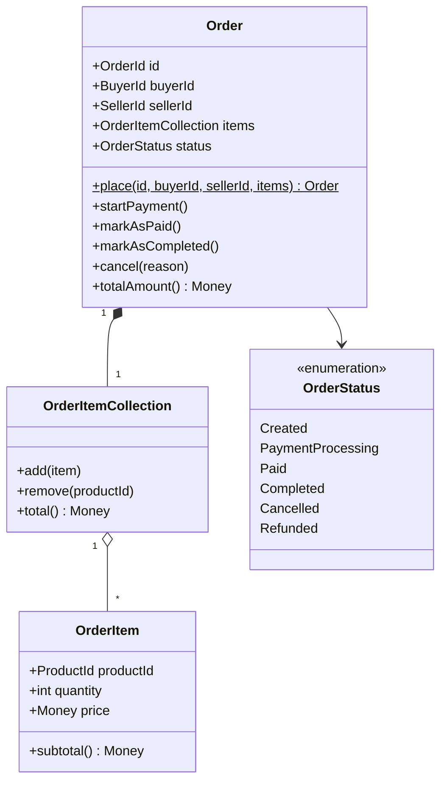
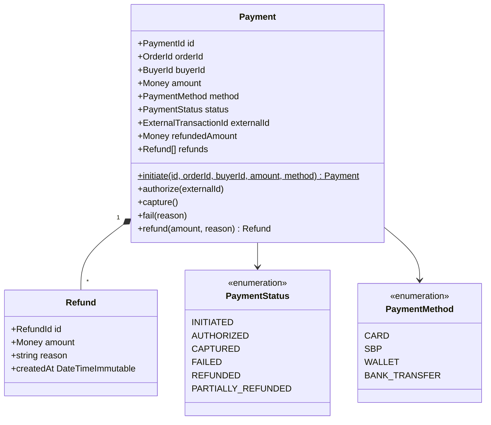
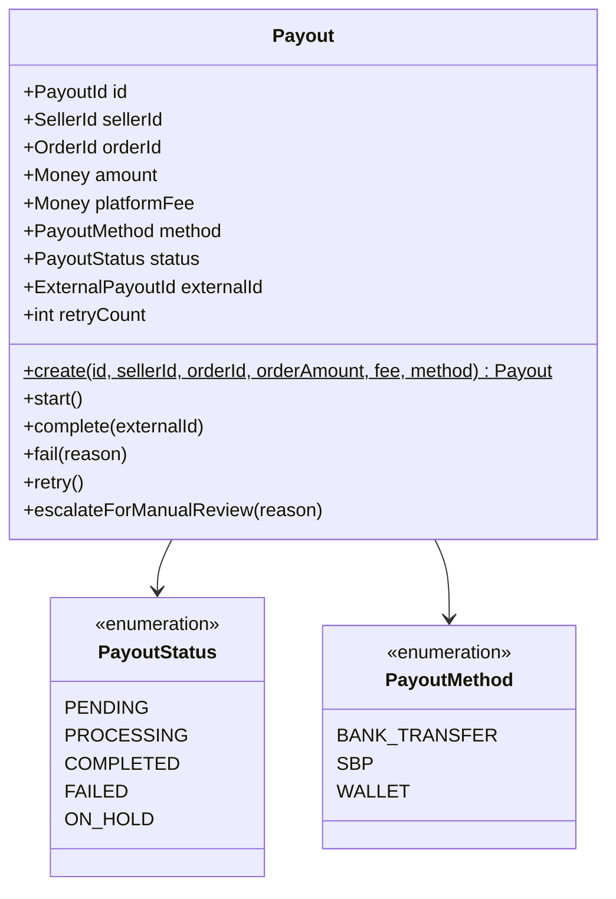
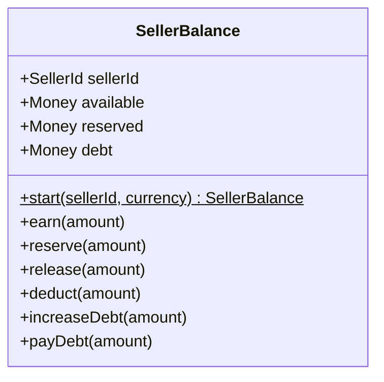

[← Documentation Index](README.md) · [← Architecture](architecture.md)

# Bounded Contexts

Marketplace Payments is split into three bounded contexts, each deployed as
its own service with its own database and its own ubiquitous language. This
document describes the domain model of each context.

For the system-level view, see [Architecture](architecture.md).

---

## Overview

| Service | Aggregate roots | Owns | Key concepts |
|---|---|---|---|
| **Order** | `Order` | Order lifecycle, `OrderFulfillmentSaga` | Buyer intent, seller reference, item list, order status |
| **Payment** | `Payment` | Payment lifecycle, partial/full refunds | Buyer charge, external gateway transaction, refund ledger |
| **Payout** | `Payout`, `SellerBalance` | Payout lifecycle, seller balance ledger | Platform fee, seller payment, debt tracking |

Each service exposes only its HTTP API and its integration contracts. Its
domain model is private.

---

## Order Service

The Order Service is the entry point of the platform and hosts the Saga.
It owns the concept of a customer order and orchestrates everything that
happens after it is placed.

### Order Aggregate



**Invariants:**

- An order must contain at least one item.
- `startPayment()` is allowed only from `Created`.
- `markAsPaid()` is allowed only from `PaymentProcessing`.
- `markAsCompleted()` is allowed only from `Paid`.
- `cancel()` is allowed from `Created`, `PaymentProcessing`, or `Paid`.
  Cancelling a `Paid` order produces `Refunded` instead of `Cancelled`.

**Lifecycle:**

```
Created ──► PaymentProcessing ──► Paid ──► Completed
   │              │                │
   └──────────────┴────────────────┴──► Cancelled / Refunded
```

### Value Objects

| VO | Purpose | Validation |
|---|---|---|
| `OrderId` | Aggregate identity | UUID v4 format |
| `BuyerId` | Reference to a buyer | Non-empty string, max 64 chars |
| `SellerId` | Reference to a seller | Non-empty string, max 64 chars |
| `ProductId` | Reference to a product | Non-empty string, max 64 chars |
| `Money` | Immutable monetary value | Non-negative amount, non-empty currency |

All value objects are `final readonly` and validate in the constructor.
They are compared by value via `equals()`, not by identity.

### Domain Events

| Event | Emitted by | Contains |
|---|---|---|
| `OrderCreated` | `Order::place()` | orderId, buyerId, sellerId, totalAmount |
| `PaymentStarted` | `Order::startPayment()` | orderId, amount |
| `OrderPaid` | `Order::markAsPaid()` | orderId, sellerId, amount |
| `OrderCompleted` | `Order::markAsCompleted()` | orderId, sellerId, amount |
| `OrderCancelled` | `Order::cancel()` (when not paid) | orderId, reason |
| `OrderRefunded` | `Order::cancel()` (when paid) | orderId, amount, reason |

Events are recorded in an internal buffer and released after the repository
flushes the aggregate. See [Architecture → Transactions](architecture.md#transactions).

### Saga

The `OrderFulfillmentSaga` orchestrates the order lifecycle across all three
services. Its state is persisted in `ecotone_document_store`. Full details in
[Saga Flow](saga-flow.md).

---

## Payment Service

The Payment Service owns everything related to charging the buyer. It
emulates an external card gateway behind the `PaymentGateway` interface —
the real provider is not the concern of this bounded context.

### Payment Aggregate



**Invariants:**

- `amount` must be positive.
- `authorize()` is allowed only from `INITIATED`.
- `capture()` is allowed only from `AUTHORIZED`.
- `fail()` is forbidden from `REFUNDED` (any refundable state allows `fail`).
- `refund()` is allowed only from `CAPTURED` or `PARTIALLY_REFUNDED`.
- Cumulative refunds cannot exceed the captured amount.
- Full refund transitions to `REFUNDED`; partial to `PARTIALLY_REFUNDED`.

**Lifecycle:**

```
INITIATED ──► AUTHORIZED ──► CAPTURED ──► REFUNDED
     │                          │
     └──► FAILED                └──► PARTIALLY_REFUNDED ──┐
                                                         │
                                          (refund again) ┘
```

### `Refund` is an entity, not an aggregate

`Refund` is created and accessed exclusively through its parent `Payment`.
It has its own identity (`RefundId`) but no global lifecycle — it never
exists outside the aggregate. All invariants that touch refunds are enforced
on `Payment`.

### Value Objects

| VO | Purpose | Validation |
|---|---|---|
| `PaymentId` | Aggregate identity | UUID v4 |
| `RefundId` | Refund entity identity | UUID v4 |
| `OrderId` | Reference to an external aggregate | UUID v4 |
| `BuyerId` | Reference to a buyer | Non-empty |
| `ExternalTransactionId` | Identifier from the payment provider | Non-empty |
| `Money` | Monetary value | Non-negative, non-empty currency |

Note: `OrderId`, `BuyerId`, and `Money` also appear in Order Service. They
are **not** the same class — see [Shared Concepts](#shared-concepts).

### Domain Events

| Event | Emitted by | Contains |
|---|---|---|
| `PaymentInitiated` | `Payment::initiate()` | paymentId, orderId, buyerId, amount, method |
| `PaymentAuthorized` | `Payment::authorize()` | paymentId, externalId |
| `PaymentCaptured` | `Payment::capture()` | paymentId, orderId, amount |
| `PaymentFailed` | `Payment::fail()` | paymentId, reason |
| `PaymentRefunded` | `Payment::refund()` | paymentId, refundId, amount, reason |

---

## Payout Service

The Payout Service owns everything related to paying sellers. It also owns
the seller balance ledger — how much each seller is owed, how much is
currently reserved, and how much debt they carry.

### Payout Aggregate



**Invariants:**

- `orderAmount` must be positive.
- Platform fee cannot consume the entire order amount.
- `amount` equals `orderAmount - platformFee` and represents what the seller
  actually receives.
- `retry()` increments `retryCount` and moves back to `PROCESSING`.
- `retry()` is forbidden when `retryCount >= MAX_RETRY_COUNT` (5).
- `escalateForManualReview()` is allowed only from `FAILED` and only after
  `retryCount` has reached `MAX_RETRY_COUNT`.

**Lifecycle:**

```
PENDING ──► PROCESSING ──► COMPLETED
                │
                ▼
             FAILED ──► PROCESSING (retry, up to 5 times)
                │
                ▼
             ON_HOLD (manual review)
```

### SellerBalance Aggregate

`SellerBalance` is a separate aggregate with `SellerId` as its identity. It
maintains three balances per seller and is always updated in the same
transaction as the corresponding `Payout` transition.



**Money flows:**

| Method | Effect | Trigger |
|---|---|---|
| `earn(amount)` | `available += amount` | Order completed — seller's cut becomes payable |
| `reserve(amount)` | `available -= amount`, `reserved += amount` | Payout started |
| `release(amount)` | `reserved -= amount`, `available += amount` | Payout failed transiently |
| `deduct(amount)` | `reserved -= amount` | Payout completed, money left the platform |
| `increaseDebt(amount)` | `debt += amount` | Payout escalated — seller owes the platform |
| `payDebt(amount)` | `debt -= amount` | Debt settled (out of scope for this demo) |

**Invariants:**

- Cannot reserve more than `available`.
- Cannot release more than `reserved`.
- Cannot deduct more than `reserved`.
- Cannot pay more than `debt`.
- All amounts must be positive.

Note: `SellerBalance` and `Payout` are separate aggregates but are always
modified together in the same handler. This keeps them consistent without a
distributed transaction.

### Value Objects

| VO | Purpose | Validation |
|---|---|---|
| `PayoutId` | Aggregate identity | UUID v4 |
| `SellerId` | Aggregate identity (for `SellerBalance`) | Non-empty |
| `OrderId` | Reference to an external aggregate | UUID v4 |
| `ExternalPayoutId` | Identifier from the payout provider | Non-empty |
| `Money` | Monetary value | Non-negative, non-empty currency |
| `PlatformFee` | Commission in basis points | Between 0 and 10000 bps |

### Domain Events

| Event | Emitted by | Contains |
|---|---|---|
| `PayoutCreated` | `Payout::create()` | payoutId, sellerId, orderId, amount, platformFee, method |
| `PayoutCompleted` | `Payout::complete()` | payoutId, orderId, sellerId, externalId, amount |
| `PayoutFailed` | `Payout::fail()` | payoutId, orderId, sellerId, reason |
| `PayoutEscalated` | `Payout::escalateForManualReview()` | payoutId, orderId, sellerId, reason |

`PayoutFailed` is emitted on every transient failure and stays internal to
the service. Only `PayoutEscalated` is published externally as `payout.failed`.

---

## Shared Concepts

The same identifier appears in more than one service — `OrderId` in all
three, `SellerId` in Order and Payout, `Money` everywhere. This is **not** a
duplication problem. The classes share code today, but they carry different
semantics in each context.

### `OrderId`

| Context | Meaning |
|---|---|
| **Order** | The aggregate's identity. Generated by `Order::place()`. |
| **Payment** | A reference to an aggregate owned by another service. Payment never loads it — it just carries it. |
| **Payout** | Same — a reference used to correlate payout to order. |

If tomorrow Payment decides to validate `OrderId` against a specific format,
and Order decides not to, the two classes can diverge without touching one
another. This is what bounded contexts are for.

### `Money`

The value object looks identical in all three services, but the surrounding
semantics differ:

- In **Order**, `Money` is a total order amount.
- In **Payment**, `Money` is a charge and a cumulative refunded amount.
- In **Payout**, `Money` is a seller's net payout and a platform fee.

Coupling them would create a shared kernel of domain code — the exact thing
[Design Decisions → Out of Scope](decisions.md#3-shared-kernel-for-domain-code)
argues against.

### Integration contracts are the exception

The one thing that genuinely crosses service boundaries is the DTO layer —
`OrderCreatedMessage`, `CapturePaymentMessage`, `PaymentCompletedMessage`,
`CreatePayoutMessage`, `PayoutCompletedMessage`, `PayoutFailedMessage`.
These live in [`shared/contracts/`](../shared/contracts/). They contain no
domain logic — just plain immutable data.

Rule of thumb: **integration contracts go to the shared kernel; domain
concepts stay in their bounded context.**

---

## Repository Contracts

Each aggregate root has a repository interface defined in the domain layer.
The interface lives in `App\Domain\Repository`, the implementation lives in
`App\Infrastructure\Persistence\Doctrine`.

| Service | Repository | Methods |
|---|---|---|
| Order | `OrderRepository` | `save`, `findById`, `nextIdentity` |
| Payment | `PaymentRepository` | `save`, `findById`, `findByOrderId`, `nextIdentity` |
| Payout | `PayoutRepository` | `save`, `findById`, `findByOrderId`, `nextIdentity` |
| Payout | `SellerBalanceRepository` | `save`, `findBySellerId` |

Repositories only persist; they contain no business logic. Queries that need
cross-aggregate reads go through dedicated handlers, not through repositories.

---

## References

- **Domain-Driven Design** — Eric Evans (2003), Part II: *The Building Blocks of a Model-Driven Design*
- **Implementing Domain-Driven Design** — Vaughn Vernon (2013), Chapter 10: *Aggregates*
- **Value Object pattern** — [martinfowler.com/bliki/ValueObject.html](https://martinfowler.com/bliki/ValueObject.html)
- **Repository pattern** — [martinfowler.com/eaaCatalog/repository.html](https://martinfowler.com/eaaCatalog/repository.html)

---

**Continue reading:**
[← Architecture](architecture.md) · [Documentation Index](README.md) · [Saga Flow →](saga-flow.md)