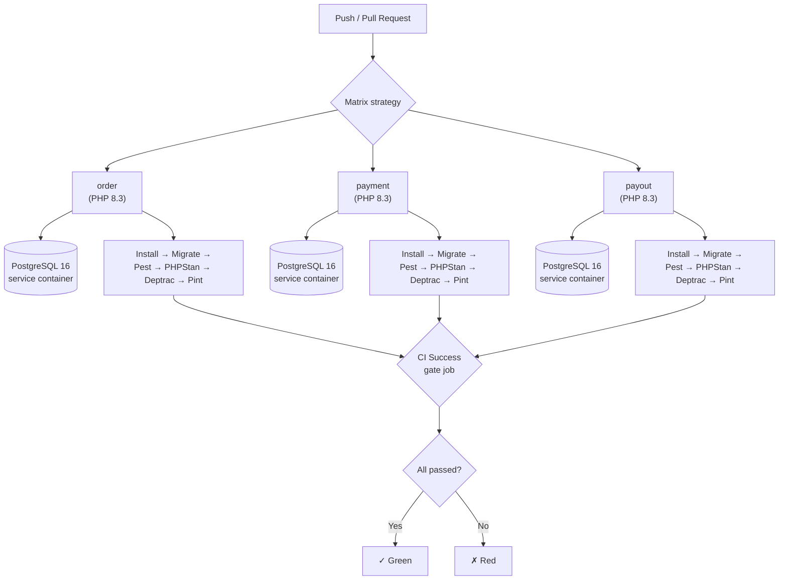

[← Documentation Index](README.md) · [← Running Locally](running-locally.md)

# CI/CD

Continuous integration runs on every push and pull request to `main` / `master`.
Every change passes through a matrix of three services, each checked against
four quality gates against a fresh PostgreSQL instance.

This document covers the workflow structure, each pipeline step, the reasons
behind the matrix choices, and how to extend the pipeline.

---

## Overview

The CI workflow is defined in a single file:

```
.github/workflows/ci.yml
```

It runs whenever:

- A commit is pushed to `main` or `master` and touches `services/**` or
  the workflow file itself.
- A pull request targets `main` or `master` and touches the same paths.

The `paths` filter avoids running the pipeline on documentation-only changes,
which would waste several minutes of runner time.

---

## Pipeline Diagram



The three matrix jobs run **in parallel**. Each is fully isolated: its own
runner, its own Postgres service container, its own copy of the repository.
No shared state between them.

The `ci-success` job at the end is a **gate** — it fails if any matrix job
fails, and succeeds otherwise. Branch protection is configured against this
single job, not against the three individual ones.

---

## Matrix Strategy

```yaml
strategy:
  fail-fast: false
  matrix:
    service: [order, payment, payout]
    php: ['8.3']
```

**Three services** — `order`, `payment`, `payout`. All three go through
identical pipelines. Any change to a shared contract (like
`shared/contracts/`) triggers all three, because the `paths` filter matches
`services/**`.

**`fail-fast: false`** — if one service fails, the others still complete.
This gives a full picture of what's broken in a single run, instead of
stopping at the first failure.

**PHP 8.3 only** — not a matrix of `['8.2', '8.3']`. Reason:

Each service's `composer.json` declares:

```json
"config": {
    "platform": {
        "php": "8.3.0"
    }
}
```

The `platform` directive instructs Composer to resolve dependencies **as if
the environment were PHP 8.3**, regardless of the actual runtime. On PHP 8.2
the runner would install packages that require 8.3 features, and then fail
at runtime with parse errors or missing functions.

Adding 8.2 support is possible but requires:

1. Removing `platform` from all three `composer.json` files.
2. Pinning dependency versions that support both 8.2 and 8.3.
3. Adding `'8.2'` to the matrix.

This is deferred — the project targets 8.3 as the production runtime. See
[Design Decisions → Out of Scope](decisions.md#deliberately-out-of-scope).

---

## Pipeline Steps

The `test` job runs these steps in order. Every step must succeed before the
next one runs.

### 1. Checkout

```yaml
- uses: actions/checkout@v4
```

Clones the repository into `$GITHUB_WORKSPACE`. The full repository is
checked out — including `shared/contracts/`, which is referenced by the
services via relative autoload paths.

### 2. Setup PHP

```yaml
- uses: shivammathur/setup-php@v2
  with:
    php-version: ${{ matrix.php }}
    extensions: mbstring, pdo, pdo_pgsql, bcmath, intl, json, openssl, xml, curl, zip
    coverage: none
    tools: composer:v2
```

Installs PHP 8.3 and the extensions Laravel + Doctrine + Ecotone require.
`coverage: none` skips Xdebug — we don't collect coverage, so installing it
would only slow the pipeline.

### 3. Prepare `.env`

```yaml
- name: Prepare .env for CI
  run: |
    cp .env.example .env
    sed -i "s|^DB_HOST=.*|DB_HOST=127.0.0.1|" .env
    sed -i "s|^DB_PORT=.*|DB_PORT=5432|" .env
    sed -i "s|^DB_DATABASE=.*|DB_DATABASE=test_db|" .env
    sed -i "s|^DB_USERNAME=.*|DB_USERNAME=test_user|" .env
    sed -i "s|^DB_PASSWORD=.*|DB_PASSWORD=test_pass|" .env
    sed -i "s|^RABBITMQ_HOST=.*|RABBITMQ_HOST=127.0.0.1|" .env
    sed -i "s|^RABBITMQ_USER=.*|RABBITMQ_USER=guest|" .env
    sed -i "s|^RABBITMQ_PASSWORD=.*|RABBITMQ_PASSWORD=guest|" .env
    sed -i "s|^ECOTONE_SERVICE_NAME=.*|ECOTONE_SERVICE_NAME=${{ matrix.service }}_service|" .env
```

The `.env` file is created **before** `composer install` — this is critical.
The `post-autoload-dump` composer script runs `php artisan package:discover`,
which loads Ecotone. Ecotone reads `ECOTONE_SERVICE_NAME` from the environment
at boot time; without it, `package:discover` fails.

The `sed` calls replace placeholder values from `.env.example` with
CI-specific ones. This works because `.env.example` already contains the
variable names — the `sed` pattern matches the key and replaces the value.

### 4. Cache Composer dependencies

```yaml
- name: Resolve composer cache directory
  id: composer-cache
  run: echo "dir=$(composer config cache-files-dir)" >> "$GITHUB_OUTPUT"

- name: Cache composer dependencies
  uses: actions/cache@v4
  with:
    path: ${{ steps.composer-cache.outputs.dir }}
    key: ${{ runner.os }}-php-${{ matrix.php }}-${{ matrix.service }}-composer-${{ hashFiles(format('services/{0}/src/composer.lock', matrix.service)) }}
    restore-keys: |
      ${{ runner.os }}-php-${{ matrix.php }}-${{ matrix.service }}-composer-
```

Composer downloads packages to a cache directory. Caching it across runs
saves 30–60 seconds per job. The cache key includes the `composer.lock` hash,
so any dependency change invalidates the cache and triggers a fresh download.

### 5. Install dependencies

```yaml
- name: Install dependencies
  run: composer install --prefer-dist --no-interaction --no-progress --optimize-autoloader
```

Standard flags:

- `--prefer-dist` — download ZIP archives instead of cloning git repositories.
- `--no-interaction` — never prompt; fail if input would be required.
- `--no-progress` — quieter output, faster logs.
- `--optimize-autoloader` — generate a class map for faster autoloading.

### 6. Generate application key

```yaml
- name: Generate application key
  run: php artisan key:generate
```

Writes `APP_KEY` into `.env`. Laravel requires it for encryption, sessions,
and CSRF tokens. The test stack doesn't exercise these, but the framework
initialises them at boot time and fails if `APP_KEY` is missing.

### 7. Run migrations

```yaml
- name: Run Laravel migrations
  run: php artisan migrate --force

- name: Run Doctrine migrations
  run: php artisan doctrine:migrations:migrate --no-interaction
```

Two migration sets:

- **Laravel migrations** create framework tables (`cache`, `jobs`, `sessions`,
  `users`).
- **Doctrine migrations** create aggregate tables (`orders`, `payments`,
  `payouts`, `seller_balances`).

Both run against the CI Postgres service container, freshly created for each
job. No persistent data; no cleanup needed.

### 8. Run quality gates

The remaining four steps are the actual quality checks. They run in this
order — cheapest and most likely to fail first, so a broken test fails fast
and skips the more expensive analyses.

```yaml
- name: Run Pest
  run: ./vendor/bin/pest --colors=always

- name: Run PHPStan
  run: ./vendor/bin/phpstan analyse --no-progress --error-format=github

- name: Run Deptrac
  run: ./vendor/bin/deptrac analyse --no-progress

- name: Run Pint (dry-run)
  run: ./vendor/bin/pint --test app/Domain app/Application app/Infrastructure app/Presentation tests
```

---

## Quality Gates

| Gate | Tool | What it catches | Level |
|---|---|---|---|
| **Tests** | Pest 3 | Behaviour regressions | 77 tests / 220 assertions |
| **Static analysis** | PHPStan + Larastan | Type errors, nullability, dead code | Level 8 |
| **Architecture** | Deptrac | Layer boundary violations | 4 layers |
| **Code style** | Pint | Formatting, unused imports, strict types | Laravel preset |

### Pest

Behavioural tests in three tiers:

- **Unit** — Value Objects, aggregates, invariants. No framework.
- **Feature** — command handlers, consumers, notifiers, API endpoints.
  Wrapped in a Doctrine transaction, rolled back. `DistributedBus` is mocked
  so tests never touch RabbitMQ.
- **E2E** — full saga flow through the running stack. Not part of CI (needs
  three services running); run manually via Docker.

### PHPStan (level 8)

Level 8 is the strictest level PHPStan ships with. It checks:

- Every method call has a resolvable type.
- Nullable values are handled before use.
- Array shapes match declared types.
- No dead code, no unused parameters.

`--error-format=github` produces GitHub Actions annotations — errors appear
directly on the changed lines in the PR diff.

### Deptrac

Enforces architectural boundaries defined in `deptrac.yaml`. Four layers per
service:

- **Domain** — depends on Domain and Doctrine mapping attributes only.
- **Application** — depends on Domain, Ecotone messaging attributes, PSR.
- **Infrastructure** — depends on Domain, Application, Framework.
- **Presentation** — depends on Domain, Application, Infrastructure, Laravel.

Plus a fifth layer `SharedContracts` for the integration DTOs. Domain layer
is **not allowed** to depend on SharedContracts — the contract layer is for
application-level integration only.

A single violation fails the build. This makes architectural drift visible
immediately, before it has a chance to spread.

### Pint

Code style checker, dry-run mode. Fails if any file needs reformatting.
Ensures:

- `declare(strict_types=1);` in every file.
- `final` on all classes (`final_class` rule).
- Imports sorted alphabetically.
- Single quotes, trailing commas, short array syntax.

To fix locally:

```bash
docker compose exec order-app ./vendor/bin/pint \
  app/Domain app/Application app/Infrastructure app/Presentation tests
```

---

## Postgres Service Container

Each matrix job runs a dedicated Postgres instance defined as a GitHub
Actions service:

```yaml
services:
  postgres:
    image: postgres:16-alpine
    env:
      POSTGRES_DB: test_db
      POSTGRES_USER: test_user
      POSTGRES_PASSWORD: test_pass
    ports:
      - 5432:5432
    options: >-
      --health-cmd "pg_isready -U test_user -d test_db"
      --health-interval 5s
      --health-timeout 5s
      --health-retries 10
```

**Why a service container, not Docker Compose:**

- GitHub provisions it before the job starts and tears it down afterwards.
- It runs alongside the job container on the same network; the app connects
  via `127.0.0.1:5432`.
- The health check ensures Postgres is fully booted before the first step
  runs — no `sleep` calls, no race conditions.
- Using Docker Compose inside a job is slower and requires manual
  orchestration of service readiness.

**No RabbitMQ service.** Feature tests set `QUEUE_CONNECTION=sync`, so
asynchronous endpoints execute inline. RabbitMQ is never touched. Distributed
bus calls are mocked in `tests/Pest.php`:

```php
$distributedBus = Mockery::mock(DistributedBus::class);
$distributedBus->shouldReceive('convertAndPublishEvent')->zeroOrMoreTimes();
$distributedBus->shouldReceive('convertAndSendCommand')->zeroOrMoreTimes();
$this->app->instance(DistributedBus::class, $distributedBus);
```

---

## The `ci-success` Gate Job

```yaml
ci-success:
  name: CI Success
  needs: test
  runs-on: ubuntu-latest
  if: always()
  steps:
    - name: Verify all matrix jobs passed
      run: |
        if [ "${{ needs.test.result }}" != "success" ]; then
          echo "::error::One or more matrix jobs failed."
          exit 1
        fi
        echo "All matrix jobs passed."
```

**Why a gate job exists:**

Branch protection on GitHub can require a single status check. If you point
it at the matrix, you would need to configure it against three checks
(`order (PHP 8.3)`, `payment (PHP 8.3)`, `payout (PHP 8.3)`) and update the
list whenever the matrix changes.

The gate job gives one stable check name: **`CI Success`**. When you add a
new service to the matrix, `ci-success` still works — it only looks at
`needs.test.result`, which is `success` only when all matrix legs passed.

`if: always()` forces the gate job to run even when `test` fails. Without
this, a matrix failure would skip the gate entirely, and GitHub would show
a "pending" status instead of "failed".

---

## Branch Protection Setup

Once CI is green on `master`, configure branch protection:

**GitHub → Settings → Branches → Add branch protection rule**

1. **Branch name pattern:** `master` (or `main`)
2. **Require a pull request before merging** — optional, recommended for teams
3. **Require status checks to pass before merging:**
    - Search for and select **`CI Success`**
4. **Require branches to be up to date before merging** — optional, stricter

With this in place, no PR can be merged until `CI Success` is green. A red
matrix fails the gate, which blocks the merge.

---

## Extending the Pipeline

### Adding a new service

1. Add the service directory under `services/`.
2. Add its name to the matrix:

   ```yaml
   matrix:
     service: [order, payment, payout, notifications]
   ```

3. Add the `.env` bootstrap if the service needs different variables.
4. No changes to `ci-success` — the gate picks up the new matrix leg
   automatically.

### Adding a new quality gate

Add a step to the `test` job after the existing gates:

```yaml
- name: Run Rector (dry-run)
  run: ./vendor/bin/rector process --dry-run
```

Add the corresponding dev dependency to each service's `composer.json` and
install it. The gate becomes part of the required status checks automatically
via `ci-success`.

### Adding another PHP version

Only if the `platform` directive is removed from all three `composer.json`
files (see [Matrix Strategy](#matrix-strategy)):

```yaml
matrix:
  service: [order, payment, payout]
  php: ['8.2', '8.3']
```

The matrix expands to **6 jobs**. Runner minutes double. Consider whether the
compatibility guarantee is worth the cost.

---

## Running CI Locally

The pipeline is designed so every step can be reproduced locally via Docker
Compose. This is useful for debugging before pushing.

### Full local reproduction

```bash
# 1. Start the local stack (same Postgres version as CI)
docker compose up -d

# 2. Run migrations
for svc in order payment payout; do
  docker compose exec ${svc}-app php artisan migrate --force
  docker compose exec ${svc}-app php artisan doctrine:migrations:migrate --no-interaction
done

# 3. Run all gates per service (matches CI order)
for svc in order payment payout; do
  echo "=== ${svc} ==="
  docker compose exec ${svc}-app ./vendor/bin/pest
  docker compose exec ${svc}-app ./vendor/bin/phpstan analyse --no-progress
  docker compose exec ${svc}-app ./vendor/bin/deptrac analyse --no-progress
  docker compose exec ${svc}-app ./vendor/bin/pint --test \
    app/Domain app/Application app/Infrastructure app/Presentation tests
done
```

### Using `act` for a full workflow replay

[`act`](https://github.com/nektos/act) runs GitHub Actions workflows locally
in Docker. It doesn't support service containers well, but it can be used
for a partial dry-run:

```bash
# Install act first — see repository README
act -j test --matrix service:order
```

Expect limitations: caching, service containers, and matrix behaviour may
differ slightly from GitHub-hosted runners. For final verification, always
push to a branch and let the real workflow run.

---

## References

- **GitHub Actions documentation** — [docs.github.com/actions](https://docs.github.com/actions)
- **Service containers** — [docs.github.com/actions/using-containerized-services](https://docs.github.com/actions/using-containerized-services)
- **`shivammathur/setup-php`** — [github.com/shivammathur/setup-php](https://github.com/shivammathur/setup-php)
- **`actions/cache`** — [github.com/actions/cache](https://github.com/actions/cache)
- **Branch protection rules** — [docs.github.com/repositories/configuring-branches-and-merges-in-your-repository](https://docs.github.com/repositories/configuring-branches-and-merges-in-your-repository)
- **PHPStan** — [phpstan.org](https://phpstan.org/)
- **Deptrac** — [github.com/deptrac/deptrac](https://github.com/deptrac/deptrac)
- **Laravel Pint** — [laravel.com/docs/11.x/pint](https://laravel.com/docs/11.x/pint)
- **Pest** — [pestphp.com](https://pestphp.com/)

---

**Continue reading:**
[← Running Locally](running-locally.md) · [Documentation Index](README.md) · [Design Decisions →](decisions.md)