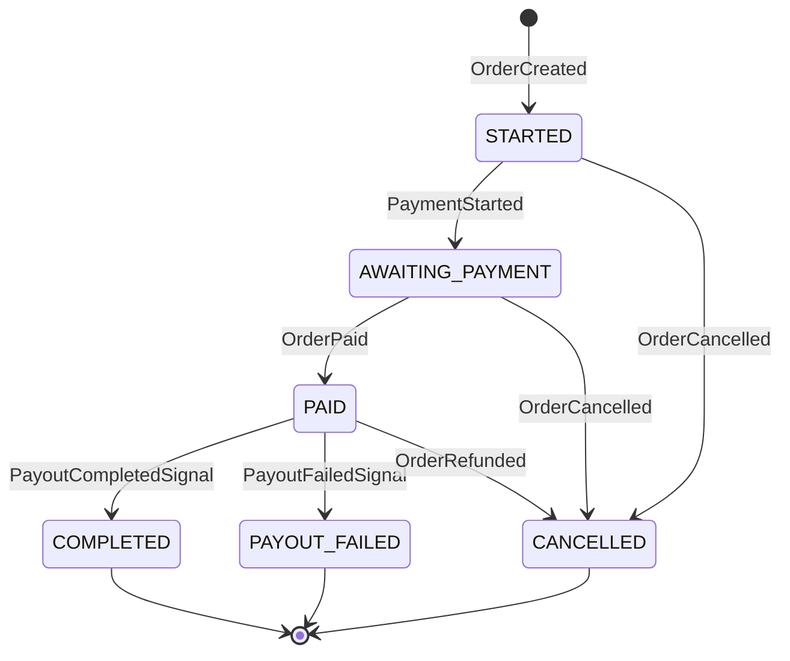
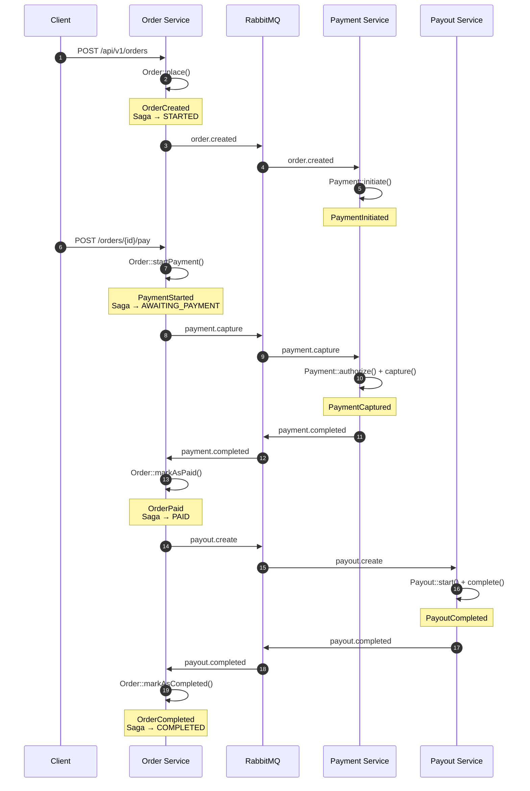
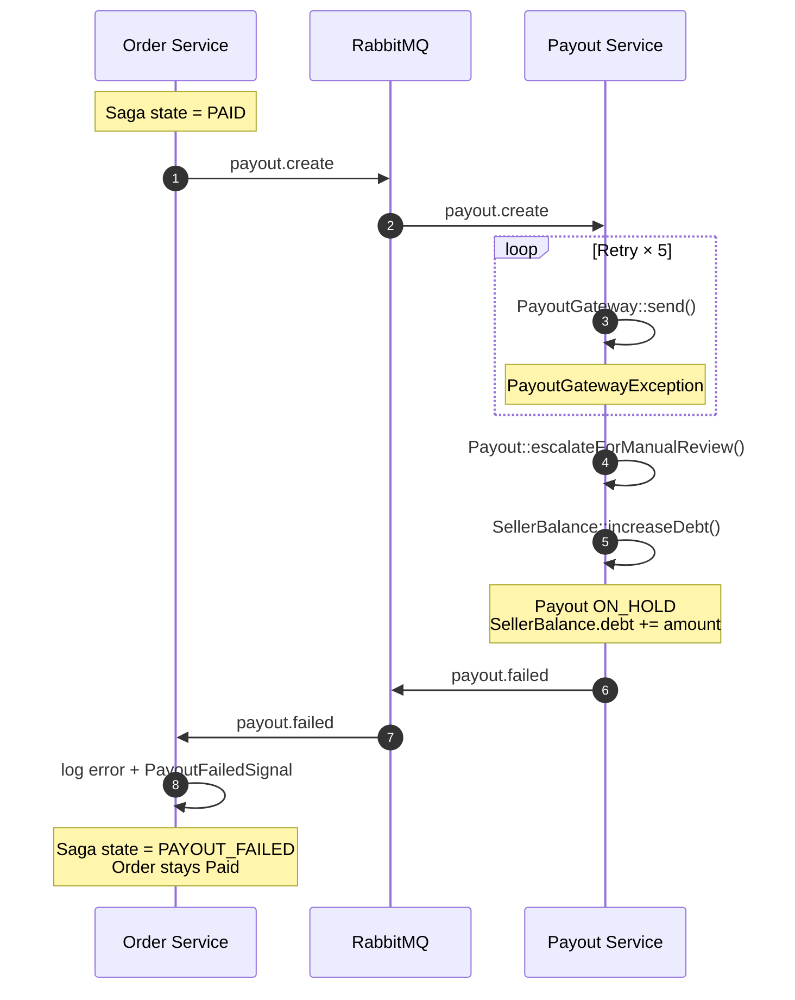

[← Documentation Index](README.md) · [← Bounded Contexts](bounded-contexts.md)

# Saga Flow

The Order Fulfilment Saga is the heart of the platform. It coordinates the
three services through the full order lifecycle — from `OrderCreated` to
`OrderCompleted`, with compensation paths when a step fails irrecoverably.

This document covers the saga's design, its state machine, both happy and
compensation paths, and how it survives service restarts.

---

## Why a Saga

An order spans three services and four state transitions. A naive approach
would use synchronous HTTP calls between services:

```
Order::place() --HTTP--> Payment::initiate()
              --HTTP--> Payment::capture()
              --HTTP--> Payout::create()
```

This breaks in a distributed setting. If Payment is down, the order fails.
If Payout times out, we don't know if money moved. If Order crashes mid-flow,
the whole thing dangles.

A **Saga** solves this by modelling the process as a long-running state
machine driven by events. Each service does its job locally and emits events;
a coordinator — the saga — decides what happens next.

Two flavours exist:

- **Choreography.** Each service listens to events and reacts. No central
  coordinator. The flow lives implicitly in the wiring between services.
- **Orchestration.** A central saga issues commands and tracks state.
  The flow is visible in one place.

We chose **orchestration**. Reasoning is in
[Design Decisions → Saga orchestration](decisions.md#saga-orchestration-not-choreography).

---

## Where the Saga Lives

The `OrderFulfillmentSaga` is a class in Order Service:

```
services/order/src/app/Application/Saga/OrderFulfillmentSaga.php
```

Its state is persisted as a JSON document in the `ecotone_document_store`
table in `order_db`. This means the saga survives service restarts — if Order
Service crashes mid-flow, the next event re-hydrates the saga from the stored
state and continues.

The saga is an Ecotone `#[Saga]` — a plain PHP class with `#[EventHandler]`
methods. Ecotone handles persistence, hydration, and message routing.

---

## State Machine



**State meanings:**

| State | Meaning | Terminal? |
|---|---|---|
| `STARTED` | Order placed, waiting for payment to begin | No |
| `AWAITING_PAYMENT` | Payment capture in flight | No |
| `PAID` | Payment captured, payout in flight | No |
| `COMPLETED` | Payout succeeded — order fulfilled | Yes |
| `CANCELLED` | Order cancelled (before or after payment) | Yes |
| `PAYOUT_FAILED` | Payout escalated for manual review | Yes |

---

## Happy Path

The complete successful flow from order placement to completion.



**Breakdown by saga transition:**

1. **`STARTED`** — set when the saga receives `OrderCreated`. The order is
   now under orchestration; nothing else needs to happen until the buyer
   initiates payment.

2. **`AWAITING_PAYMENT`** — set on `PaymentStarted`. The saga also publishes
   a `PayoutRequested` event? No — this state is passive. The order's
   `OrderPaymentStartedNotifier` independently sends `payment.capture`.

3. **`PAID`** — set on `OrderPaid`. At this point the saga becomes active:
   the same handler publishes a `PayoutRequested` domain event, which is
   picked up by `PayoutRequestedNotifier` and forwarded to Payout Service
   as `payout.create`.

4. **`COMPLETED`** — set on `PayoutCompletedSignal`. `PayoutCompletedConsumer`
   first dispatches `MarkOrderCompletedCommand` (transitioning the aggregate
   to `Completed`), then publishes `PayoutCompletedSignal`. The saga
   acknowledges and reaches its terminal state.

---

## Compensation Path — Payout Failure

When the payout gateway rejects the transfer permanently, the saga must
decide what to do. The business rule is fixed: **the buyer is not refunded**;
the seller carries the debt; the case is escalated for manual review.

### The story

1. Order is `Paid`. Saga state is `PAID`.
2. Saga sends `payout.create` to Payout Service.
3. Payout Service tries to send money via `PayoutGateway`. The gateway fails.
4. Payout Service retries synchronously up to `MAX_RETRY_COUNT = 5` times.
5. All retries fail. Payout Service:
    - Transitions `Payout` to `ON_HOLD`.
    - Moves the reserved amount from `SellerBalance.reserved` to
      `SellerBalance.debt`.
    - Emits `PayoutEscalated`.
6. `PayoutEscalatedNotifier` publishes `payout.failed` to RabbitMQ.
7. Order Service's `PayoutFailedConsumer` receives it, logs the error, and
   publishes an internal `PayoutFailedSignal`.
8. The saga receives `PayoutFailedSignal` and transitions to `PAYOUT_FAILED`.
9. Order remains `Paid`. No refund. Manual review required.

### Sequence



### Why no refund

The buyer's money has already been captured. Refunding would require
coordinating a refund with Payment Service, updating Order state, notifying
the buyer, and reversing the platform's cut. The business trade-off is:

- **Refund path cost:** high complexity, requires new integration contracts,
  new saga transitions, user-visible delay.
- **Debt path cost:** the seller owes the platform, tracked in `SellerBalance.debt`,
  resolved manually (or on the next payout cycle).

For the demo we chose debt. In a real marketplace, the choice depends on
regulations, buyer protection policies, and the seller contract.

---

## Payment Failure (not implemented)

If `payment.failed` were emitted by Payment Service (instead of
`payment.completed`), the saga would need a corresponding handler:

```php
#[EventHandler]
public function whenPaymentFailed(PaymentFailed $event): void
{
    $this->state = OrderFulfillmentState::PAYMENT_FAILED->value;
}
```

This is **deliberately not implemented** in the current version — the demo
only exercises the happy path and the payout failure path. See
[Design Decisions → Out of Scope](decisions.md#deliberately-out-of-scope).

---

## Cancellation Path

An order can be cancelled before or after payment:

- **Before payment** (`Created`, `PaymentProcessing`): `OrderCancelled` is
  emitted, saga transitions to `CANCELLED`.
- **After payment** (`Paid`): `OrderRefunded` is emitted, saga transitions
  to `CANCELLED`. The refund flow itself is out of scope for this demo.

Both events are handled by the same saga but transition to the same terminal
state.

---

## Internal vs Integration Events

The saga reacts to two kinds of events. It is important not to confuse them.

### Internal events (Order Service only)

These never leave the Order Service. They are consumed by the saga and by
notifiers within the same process.

| Event | Emitted by | Consumed by |
|---|---|---|
| `OrderCreated` | `Order::place()` | `OrderFulfillmentSaga`, `OrderCreatedNotifier` |
| `PaymentStarted` | `Order::startPayment()` | `OrderFulfillmentSaga`, `OrderPaymentStartedNotifier` |
| `OrderPaid` | `Order::markAsPaid()` | `OrderFulfillmentSaga` |
| `OrderCompleted` | `Order::markAsCompleted()` | — (no distributed notifier) |
| `PayoutRequested` | `OrderFulfillmentSaga` | `PayoutRequestedNotifier` |
| `PayoutCompletedSignal` | `PayoutCompletedConsumer` | `OrderFulfillmentSaga` |
| `PayoutFailedSignal` | `PayoutFailedConsumer` | `OrderFulfillmentSaga` |

### Integration events (cross-service via RabbitMQ)

These are the public contracts between services. They are described in
[`shared/contracts/`](../shared/contracts/) and travel through RabbitMQ.

| Routing key | Producer | Consumer |
|---|---|---|
| `order.created` | Order | Payment |
| `payment.capture` | Order | Payment |
| `payment.completed` | Payment | Order |
| `payout.create` | Order | Payout |
| `payout.completed` | Payout | Order |
| `payout.failed` | Payout | Order |

The pattern: **domain events trigger notifiers; notifiers publish integration
events.** The saga never publishes to RabbitMQ directly. This keeps the
saga's contract stable even if routing keys change.

---

## Persistence and Restart Resilience

The saga's state is stored in `order_db.ecotone_document_store`. After every
event handler, Ecotone persists the updated saga document. If Order Service
crashes:

1. Any in-flight message in RabbitMQ stays in the queue.
2. When Order Service restarts, its consumer reconnects.
3. The saga is re-hydrated from `ecotone_document_store` on the next event.
4. Processing continues from where it left off.

**No saga state is lost in a crash.** This is why the saga lives in a
document store and not in memory.

### Inspecting saga state

```bash
docker compose exec order-db psql -U order_user -d order_db -c \
  "SELECT document->>'state' AS state, document->>'orderId' AS order_id
   FROM ecotone_document_store
   WHERE document->>'orderId' = 'YOUR-ORDER-UUID';"
```

Expected output after a successful order:

```
   state   |              order_id
-----------+--------------------------------------
 completed | 390e8c2e-a05c-42a0-8f36-01637716f49e
```

After a payout failure:

```
     state      |              order_id
----------------+--------------------------------------
 payout_failed  | 685e0063-6fa2-43d7-bf6c-17161c4dcc6b
```

To reset saga state during local development:

```bash
docker compose exec order-app php artisan tinker --execute="
DB::table('ecotone_document_store')->truncate();
DB::table('ecotone_deduplication')->truncate();
"
```

---

## Correlation IDs

Every message that flows through the saga carries a `correlation_id`. It is
set when the initial command is dispatched (e.g. `PlaceOrderCommand`) and
propagated through every downstream message automatically by Ecotone.

All log lines emitted during that order's lifetime — across all three
services — carry the same `correlation_id`:

```
correlation_id: "01a12f5b-5e4e-7044-a41a-909724fde22c"
```

This makes distributed debugging tractable. Grep once, see the whole flow.

---

## Idempotency and Deduplication

At-least-once delivery means messages can arrive more than once. Two layers
protect against this:

### Layer 1 — Ecotone deduplication

Every async message carries a unique `message_id`. Ecotone records processed
IDs in `ecotone_deduplication`. A duplicate delivery is silently dropped
before the handler runs.

### Layer 2 — Handler-level guards

For cases where the message ID differs but the intent is the same — for
example, a manually re-triggered command — handlers check the current state
before mutating:

```php
// Idempotency: payout.completed may arrive more than once.
if ($order->status() === OrderStatus::Completed) {
    $this->logger->info('Order already completed, MarkOrderCompletedCommand skipped', [
        'orderId' => $command->orderId,
    ]);

    return;
}
```

Combined, these two layers make the saga safe against duplicates, retries,
and manual replays during development.

---

## References

- **Saga pattern** — [microservices.io/patterns/data/saga.html](https://microservices.io/patterns/data/saga.html)
- **Saga (original paper)** — Hector Garcia-Molina, Kenneth Salem, *Sagas* (1987)
- **Ecotone Sagas** — [docs.ecotone.tech/modelling/saga](https://docs.ecotone.tech/modelling/saga)
- **Ecotone Document Store** — [docs.ecotone.tech/modelling/dbal/document-store](https://docs.ecotone.tech/modelling/dbal/document-store)
- **Compensating transactions** — [martinfowler.com/bliki/CompensatingTransaction.html](https://martinfowler.com/bliki/CompensatingTransaction.html)

---

**Continue reading:**
[← Bounded Contexts](bounded-contexts.md) · [Documentation Index](README.md) · [Running Locally →](running-locally.md)